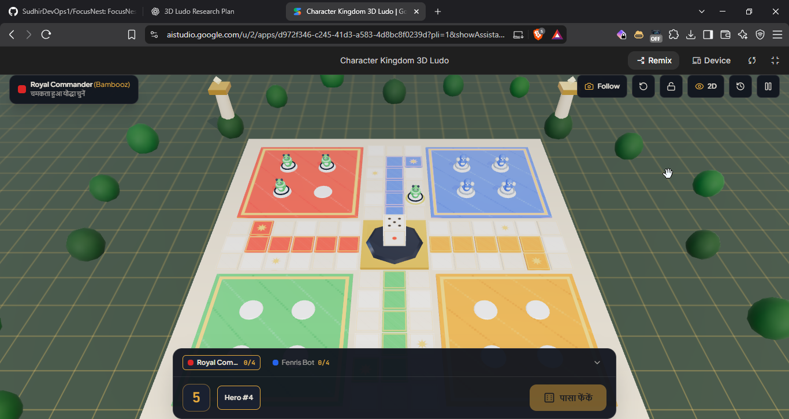

<div align="center">

  

  # 👑 KINGDOMLUDO 3D
  ### *The Royal 3D Tabletop Fantasy Island Experience*

  <p align="center">
    <b>Play as 12 Articulated Heroes • 4 Legendary Kingdoms • Living PBR Ocean Island • Authoritative Multiplayer</b>
  </p>

  <p align="center">
    <a href="https://github.com/SudhirDevOps1/KingdomLudo/actions/workflows/ci.yml"></a>
    <a href="https://github.com/SudhirDevOps1/KingdomLudo/actions/workflows/codeql.yml"></a>
    <a href="https://github.com/SudhirDevOps1/KingdomLudo/actions/workflows/android-debug.yml"></a>
    <a href="https://github.com/SudhirDevOps1/KingdomLudo/actions/workflows/web-deploy.yml"></a>
    <a href="https://github.com/SudhirDevOps1/KingdomLudo/security/code-scanning"></a>
    <a href="./LICENSE"></a>
  </p>

  <p align="center">
    <a href="#-quick-start"><b>⚡ Quick Start</b></a> •
    <a href="#-the-four-kingdom-crests"><b>🏰 The 4 Kingdoms</b></a> •
    <a href="#-hero-animation-studio"><b>⚔️ 12 Heroes</b></a> •
    <a href="#-architecture--tech-stack"><b>🛠️ Architecture</b></a> •
    <a href="#-github-secrets--environment-configuration"><b>🔐 GitHub Setup</b></a> •
    <a href="./docs/"><b>📖 Full Docs</b></a>
  </p>

  <br />

  

</div>

---

## 🏰 The Four Kingdom Crests

Choose your allegiance across four noble houses, each featuring bespoke heraldry, royal sanctuaries, and three distinct hero classes:

<table align="center" width="100%">
  <tr>
    <td align="center" width="25%">
      <br /><br />
      <b>🔴 CRIMSON SPIRE</b><br />
      <sub><b>Lord Ignis</b> (Leader)<br /><b>Lady Ember</b> (Assassin)<br /><b>General Ash</b> (Tank)</sub>
    </td>
    <td align="center" width="25%">
      <br /><br />
      <b>🔵 COBALT BASTION</b><br />
      <sub><b>Prince Tide</b> (Leader)<br /><b>Sentinel Wave</b> (Guardian)<br /><b>Admiral Marina</b> (Tactician)</sub>
    </td>
    <td align="center" width="25%">
      <br /><br />
      <b>🟢 EMERALD GROVE</b><br />
      <sub><b>Warden Grove</b> (Leader)<br /><b>Huntress Thorn</b> (Ranger)<br /><b>Sage Leaf</b> (Mystic)</sub>
    </td>
    <td align="center" width="25%">
      <br /><br />
      <b>🟡 SOVEREIGN SUN</b><br />
      <sub><b>King Aurelius</b> (Monarch)<br /><b>Knight Dawn</b> (Paladin)<br /><b>High Cleric Sol</b> (Healer)</sub>
    </td>
  </tr>
</table>

---

## 🎮 Gameplay Preview & Visual Experience

<div align="center">
  
  <p><i>Live 3D Fantasy Island: Procedural PBR ocean waves, ivory/cream stone track, star safe-havens, and animated 4-corner HUD.</i></p>
</div>

---

## 🌟 Key Features

### 🎲 1. Authentic 3D Tabletop Ludo Engine
- **Accurate 15×15 Board Topology**: 52-cell main track, 8 star sanctuaries (safe zones), 4 colored home runways, and the central Royal Crown victory dais.
- **Support for 2, 3, or 4 Players**: Automatic seat configuration and active lane lighting.
- **CSPRNG Cryptographic Dice Rolls**: Online rolls generated server-side with Node.js `crypto.randomInt(1, 7)`; offline rolls use `crypto.getRandomValues` rejection sampling.
- **Smart Adaptive AI**: 3 personality tiers:
  - 🟢 **Easy (Casual)**: Relaxed moves, casual pace.
  - 🟡 **Medium (Tactical)**: Balanced safe-zone defense and timely attacks.
  - 🔴 **Hard (Grandmaster)**: Ruthless capture prioritization, defensive stacking, and endgame calculation.

### ⚔️ 2. Hero Animation Studio & Customization
- **12 Original Articulated Heroes**: Multi-part 3D character meshes with customizable armor sets, weapons, and colorways.
- **14 Procedural & Skeletal Animation States**:
  - `Idle` (natural breathing & subtle weight shifts)
  - `Walk` (synchronized foot contact & arm swing)
  - `Run` (energetic forward sprint with body lean)
  - `Jump & Land` (knee impact compression & bounce recovery)
  - `Celebrate & Victory` (royal fanfare, backflips, and crown salute)
  - `Capture Slam` (devastating token capture strike)
- **Studio Orbit Controls**: Rotate, zoom, inspect wireframes, test individual animation clips, and import custom external `.glb` models via `GLTFLoader`.

### 🌐 3. Authoritative Multiplayer & Cloud Sync
- **Guest-First Architecture**: Jump straight into the game with cryptographic guest sessions (`gst_...`) — zero mandatory sign-up screens.
- **Supabase Cloud Sync**: Optional email or social login to preserve cross-device match statistics, leaderboard rankings, and unlocked cosmetics.
- **Express + WebSocket Engine**: Private 6-character room codes (`?room=CODE`), turn-timer enforcers, disconnect recovery, and public matchmaking lobbies.
- **Cloudflare Edge Ready**: Cloudflare Pages + Workers + Durable Objects for ultra-low latency serverless edge gameplay.

### 📱 4. Cross-Platform: PWA & Native Android
- **Progressive Web App**: Offline-ready Workbox service worker caching models, textures, and sound FX for 100% offline flight/travel play.
- **Capacitor 8 Native Android**: Compiled with modern Java 21 & Android Gradle Plugin 8.9.1 (`com.kingdomludo.app`) with custom adaptive icons, edge-to-edge UI, and physical vibration haptics.
- **2D Instant Fallback**: Hardware-accelerated 2D SVG board mode for older or low-battery mobile devices.

---

## 🛠️ Architecture & Tech Stack

```text
┌────────────────────────────────────────────────────────────────────────┐
│                        KingdomLudo Client (PWA)                        │
│   React 19  •  Three.js (WebGL)  •  Tailwind CSS  •  Lucide  •  idb     │
└───────────────────────────────────┬────────────────────────────────────┘
                                    │
                ┌───────────────────┴───────────────────┐
                ▼                                       ▼
 ┌─────────────────────────────┐         ┌─────────────────────────────┐
 │    Local Offline Engine     │         │   Online Multiplayer Mode   │
 │ • Procedural AI Bots        │         │ • WSS / Realtime WebSockets │
 │ • IndexedDB Match Storage   │         │ • Authoritative Matchmaker  │
 │ • Encrypted Safe Storage    │         │ • Server-Side Validation    │
 └─────────────────────────────┘         └──────────────┬──────────────┘
                                                        │
        ┌───────────────────────────────────────────────┴─────────────────┐
        ▼                                                                 ▼
 ┌───────────────────────────────┐               ┌──────────────────────────────┐
 │    Express + WS Game Server   │   - or -      │  Cloudflare Workers / DO     │
 │ • Rate-Limited API & Static   │               │ • Durable Objects State      │
 │ • CSPRNG Dice Generation      │               │ • Edge Latency Optimization  │
 └──────────────┬────────────────┘               └──────────────┬───────────────┘
                │                                               │
                └───────────────────────┬───────────────────────┘
                                        ▼
                         ┌─────────────────────────────┐
                         │   Supabase Cloud Platform   │
                         │ • Supabase Auth (JWT/OAuth) │
                         │ • PostgreSQL (RLS Secured)  │
                         └─────────────────────────────┘
```

| Layer | Technology |
| :--- | :--- |
| **Frontend Core** | React 19, TypeScript 5.8, Vite 8, React Router 7 |
| **3D Engine & Graphics** | Three.js (r187), WebGL, PBR Shaders, GPU-accelerated Canvas textures |
| **Styling & Animation** | Tailwind CSS v4, Motion (Framer Motion) |
| **Persistence** | IndexedDB (`idb`), Encrypted `localStorage` fallback, `node:sqlite` |
| **Multiplayer Server** | Node.js 22, Express 4, `ws` WebSockets, `express-rate-limit` |
| **Edge Serverless** | Cloudflare Pages, Cloudflare Workers, Cloudflare Durable Objects |
| **Cloud Auth & DB** | Supabase Auth, Supabase PostgreSQL with Row-Level Security (RLS) |
| **Mobile Native** | Capacitor 8 (`@capacitor/android`), Java 21, AGP 8.9.1 |
| **Quality & Security** | GitHub CodeQL (0 alerts), ESLint, Vitest, TypeScript Strict Mode |

---

## ⚡ Quick Start

### 1. Prerequisites
- **Node.js**: `v20.x` or `v22.x` (LTS recommended)
- **pnpm**: `v10.x` (recommended) or `npm` / `bun`

### 2. Installation
```bash
# Clone the repository
git clone https://github.com/SudhirDevOps1/KingdomLudo.git
cd KingdomLudo

# Install dependencies
pnpm install

# Start local development server
pnpm dev
```
Open **`http://localhost:3000`** in your browser.

---

## 🧪 Testing & Production Commands

```bash
# Typecheck & ESLint security audit
pnpm run lint

# Run Vitest unit & integration test suite (8 suites, 26 tests)
pnpm test

# Build production client bundle & PWA Service Worker
pnpm run build

# Start production Node.js + WebSocket game server
pnpm start
```

---

## 🔐 GitHub Secrets & Environment Configuration

When deploying through GitHub Actions or hosting on Cloudflare Pages and Supabase, configure your repository secrets and variables in:
👉 **`GitHub Repo → Settings → Secrets and variables → Actions`**

### 🔑 Repository Secrets (Encrypted)
| Secret Name | Required By | Description |
| :--- | :--- | :--- |
| `CLOUDFLARE_API_TOKEN` | `web-deploy.yml` | Cloudflare API Token with `Cloudflare Pages: Edit` permissions |
| `VITE_SUPABASE_URL` | Client Vite | Your Supabase project URL (`https://xyz.supabase.co`) |
| `VITE_SUPABASE_ANON_KEY` | Client Vite | Your Supabase anonymous public API key |
| `ANDROID_KEYSTORE_BASE64` | `android-release.yml` | Base64-encoded release `.jks` keystore |
| `ANDROID_KEYSTORE_PASSWORD` | `android-release.yml` | Password for the release keystore |
| `ANDROID_KEY_ALIAS` | `android-release.yml` | Key alias name inside the keystore |
| `ANDROID_KEY_PASSWORD` | `android-release.yml` | Password for the key alias |

### 🌐 Repository Variables (Plaintext)
| Variable Name | Default Value | Description |
| :--- | :--- | :--- |
| `CLOUDFLARE_ACCOUNT_ID` | *(Your Account ID)* | 32-character Cloudflare Account ID |
| `CLOUDFLARE_PAGES_PROJECT` | `kingdomludo` | Target project name on Cloudflare Pages |
| `VITE_WS_URL` | *(empty = same host)* | Remote WebSocket server URL (e.g. `wss://game.yourdomain.com/ws`) |
| `VITE_APP_NAME` | `KingdomLudo` | Custom display application title |

📖 **For full, step-by-step setup instructions with screenshots and command-line generators, read [`docs/GITHUB_SECRETS.md`](./docs/GITHUB_SECRETS.md).**

---

## 🛡️ Security Audit & Hardening (CodeQL Certified)

- **0 CodeQL Alerts**: Cleaned and hardened against CWE-770 (missing rate limiting) and CWE-312 (cleartext sensitive storage).
- **Express Rate Limiting**: Global DoS throttling (`1000 req / 15m`) and API protections (`120 req / 1m`) active on all routes.
- **Client Sanitization**: Personal Identifiable Information (PII) like emails are stripped before local fallback persistence, with XOR Base64 storage encryption.
- **Authoritative Validation**: Dice rolls, token movements, and win conditions are calculated on the authoritative server or local engine, preventing client-side packet tampering.

---

## 📁 Repository Map

```text
KingdomLudo/
├── .github/workflows/            # CI, CodeQL, Cloudflare Pages, Android Workflows
├── android/                      # Native Capacitor Android 15/16 Project (Java 21)
├── docs/                         # In-Depth Guides & Technical Architecture
│   ├── assets/                   # High-res Cover Banners, Icons, & Kingdom Crests
│   ├── ARCHITECTURE.md           # System Architecture & Topology Map
│   ├── AUTHENTICATION.md         # Supabase Auth & Guest-First Spec
│   ├── DATABASE_CONFIGURATION.md # Supabase PostgreSQL & SQLite Guide
│   └── GITHUB_SECRETS.md         # Step-by-Step GitHub Setup Guide
├── server/                       # Node.js + WebSocket Multiplayer Server
├── src/                          # React 19 Frontend Application
│   ├── components/               # UI Modals, Audio, 4-Corner HUD, Fallback 2D Board
│   ├── engine/                   # Ludo Core Rules, CSPRNG Dice, Bot AI Logic
│   ├── persistence/              # Local IDB & Encrypted Storage Handlers
│   ├── services/                 # Supabase Auth, Sound FX & Multiplayer Sync
│   └── three/                    # 3D Board, Heroes, Ocean Shaders, Materials
├── package.json                  # Scripts & Dependency Manifest
├── server.ts                     # Standalone Express + WS Production Server
├── vite.config.ts                # Vite 8 + PWA + Workbox Configuration
└── wrangler.jsonc                # Cloudflare Pages & Workers Config
```

---

## 📜 License

Distributed under the **MIT License**. See [`LICENSE`](./LICENSE) for more information.

---

<div align="center">
  <p>Crafted with 👑 and passion by <a href="https://github.com/SudhirDevOps1"><b>SudhirDevOps1</b></a> & the KingdomLudo Team.</p>
</div>
